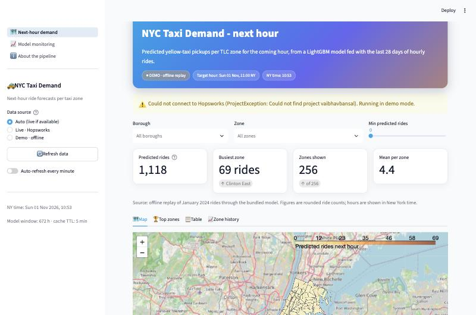

# NYC Taxi Demand - next-hour forecasts per zone

Predicts how many yellow-taxi pickups each of the 260 NYC TLC zones will see in the **next hour**.
A LightGBM model is fed the previous 28 days (672 hours) of hourly rides per zone, the feature and
prediction data live in a Hopsworks feature store, and a Streamlit app shows the forecasts on a map.



**Live app:** https://nyc-taxi-ride-v3-sdzj76dkug3gzjic6obgul.streamlit.app

| Stack | |
|---|---|
| Data | NYC TLC yellow-taxi trip records (parquet, monthly) |
| Feature store / registry | Hopsworks serverless (`eu-west.cloud.hopsworks.ai`), SDK 5.x |
| Model | scikit-learn pipeline + LightGBM regressor |
| Orchestration | GitHub Actions (hourly features, hourly inference, weekly retraining) |
| App | Streamlit + Folium + Plotly |
| Tooling | Python 3.12, `uv`/pip, pytest, ruff |

## How it works

```
TLC parquet ──▶ feature pipeline (hourly) ──▶ feature group ──▶ feature view ──┬──▶ training pipeline (weekly) ──▶ model registry
                                                                              │                                       │
                                                                              └──▶ inference pipeline (hourly) ◀──────┘
                                                                                            │
                                                                                            ▼
                                                                               predictions feature group ──▶ Streamlit app
```

1. **Feature pipeline** (`src/feature_pipeline.py`) downloads the trip files covering the last 28 days, filters
   implausible trips, aggregates them into *rides per zone per hour* and upserts them into the
   `time_series_hourly_feature_group_v4` feature group. Trip timestamps are New-York local time and are stored as UTC.
2. **Inference pipeline** (`pipelines/inference_pipeline.py`) reads the last 29 days, builds **one** 672-hour window
   per zone ending at the current hour, loads the newest registry model and writes one prediction per zone for the
   next hour into `taxi_hourly_model_prediction_v5`.
3. **Training pipeline** (`pipelines/model_training_pipeline.py`) retrains on the last 180 days, evaluates on a 7-day
   hold-out and registers the model only when its MAE beats the current one.
4. **Streamlit app** (`frontend/app.py`) has three pages:
   * *Next-hour demand* - choropleth map, top zones, borough share, filterable table, CSV download, 7-day history per zone.
   * *Model monitoring* - MAE by hour, hardest zones, actual-vs-predicted per zone over a configurable look-back.
   * *About the pipeline* - architecture diagram, configuration and current data-source status.

> **Data note.** TLC publishes trip files with a ~2-month delay. When the current month is not available the feature
> pipeline replays the same month of the previous year, so "live" numbers are a realistic simulation rather than
> real-time taxi activity.

### Live and demo modes

The app works **without** Hopsworks credentials: in *demo* mode it replays real January-2024 traffic onto today's clock and
runs the bundled model (`models/lgb_model.pkl`) locally. Mode is chosen with `APP_MODE` (`auto` | `live` | `demo`,
default `auto` = live when a key is configured and reachable, else demo) and can be switched in the sidebar.

## Quick start

```bash
git clone https://github.com/VaibhavBansal26/nyc-taxi-ride-v3.git
cd nyc-taxi-ride-v3
uv venv --python 3.12 && source .venv/bin/activate     # or: python3.12 -m venv .venv
uv pip install -r requirements.txt                       # or: pip install -r requirements.txt
cp .env.example .env                                     # add HOPSWORKS_API_KEY for live mode
streamlit run frontend/app.py
```

Open http://localhost:8501. Without an API key the app starts in demo mode.

### Hopsworks setup (live mode)

1. Create a project on [app.hopsworks.ai](https://app.hopsworks.ai) and an API key with *featurestore*, *project*,
   *job*, *kafka* and *model registry* scopes.
2. Put `HOPSWORKS_API_KEY` (and optionally `HOPSWORKS_PROJECT_NAME`) in `.env`, or as GitHub *Actions secrets* and
   Streamlit Cloud *secrets* (Streamlit exposes top-level secrets as environment variables).
3. Bootstrap the store once:

```bash
python -m src.feature_pipeline --lookback-days 60 --wait      # creates the feature group + view, loads 60 days
python -m pipelines.model_training_pipeline --register-local  # registers the bundled model as v1 (fast)
python -m pipelines.inference_pipeline --backfill-hours 48    # next-hour predictions + 48 h of history for monitoring
```

Flags worth knowing: every pipeline accepts `--dry-run` (compute but do not write); the feature pipeline has
`--lookback-days` and `--wait` (block until Hopsworks materialises the insert); training has `--force`,
`--days` and `--register-local`; inference has `--local-model` (use `models/lgb_model.pkl` instead of the registry)
and `--backfill-hours N` (regenerate the last N hours, e.g. after an outage). Once secrets are in place the GitHub
workflows take over:

| Workflow | Trigger |
|---|---|
| `feature_pipeline.yaml` | every hour at :02 |
| `inference_pipeline.yaml` | after a successful feature run |
| `model_training_pipeline.yaml` | Mondays 00:00 UTC |
| `ci.yaml` | every push / PR - ruff + pytest |

## Project layout

```
frontend/            Streamlit app (app.py entry, views/, cached data layer, shared UI)
src/
  config.py          paths, Hopsworks names, window size, APP_MODE
  data_utils.py      TLC download, trip filtering, hourly aggregation, sliding-window features
  pipeline_utils.py  scikit-learn pipeline (lag average + temporal features + LightGBM)
  inference.py       Hopsworks reads/writes, model registry access
  demo.py            offline replay engine used by demo mode and tests
  data_source.py     uniform "live or demo" data access for the app
  feature_pipeline.py
pipelines/           inference, training and feature-view entry points
tests/               pytest suite (offline, < 15 s)
notebooks/           research notebooks (01 data fetch ... 20 frontend test)
data/sample/         bundled hourly rides for demo mode; everything else in data/ is git-ignored
models/lgb_model.pkl bundled model (pipelines write the same file)
taxi_zone_lookup.csv TLC zone id -> zone / borough
```

## Development

```bash
uv pip install -r requirements-dev.txt
pytest                 # unit tests, no network needed
ruff check . && ruff format .
```

The feature frame layout `rides_t-672 … rides_t-1, pickup_location_id, pickup_hour` and the import path
`src.pipeline_utils` must stay stable - the pickled model depends on both.

## What changed in v3.1

* **Fixed crashes**: the TLC zone archive now extracts into a sub-folder (the app looked for `taxi_zones.shp` at the
  old path), removed `st.experimental_set_query_params` / `experimental_singleton` and other APIs that no longer exist
  in Streamlit, replaced pandas calls removed in 2.x/3.0 (`floor("H")`, `errors="ignore"`), and restored functions the
  training pipeline and monitoring page imported but that no longer existed.
* **Inference bug**: the hourly job built *every* 672-hour window of the last 29 days (about 24 per zone) and wrote
  them all under the same target hour; it now builds exactly one window per zone.
* **Timezones**: trip timestamps are localised to New York before being stored as UTC, so the hour-of-day feature is
  correct at inference time; all frames leaving `src/` carry tz-aware UTC timestamps.
* **Performance**: vectorised sliding windows (numpy stride tricks), cached feature/prediction reads with a 5-minute
  TTL, simplified zone geometry; the frontend no longer re-reads 29 days of features on every interaction.
* **Stack**: Python 3.12, Hopsworks SDK 4.x/5.x, Streamlit ≥ 1.40, pandas 2.x; one `pyproject.toml`, three clean
  requirements files instead of five conflicting ones; the committed virtualenv, notebook HTML export and editor
  settings were removed from git. GitHub workflows no longer compile librdkafka by hand.
* **Features**: demo mode, multi-page app with model monitoring, borough/zone/min-demand filters, top-zone and
  borough-share charts, progress-bar table, auto-refresh, dry-run flags on every pipeline, hold-out evaluation in training.
* **Tests + CI**: 15 offline tests and a lint/test workflow.
